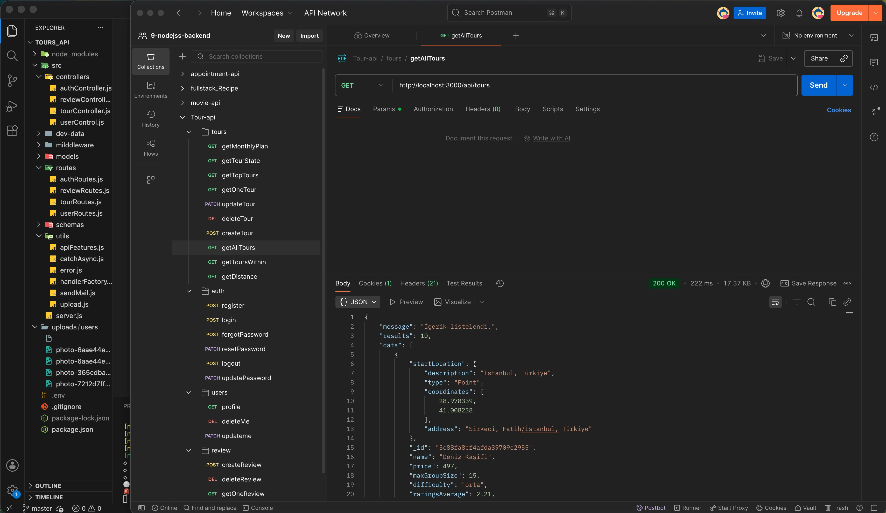
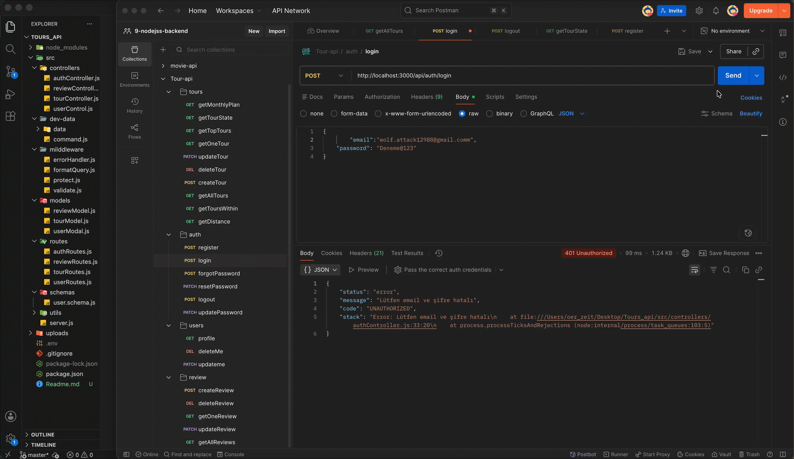

# Tours API

Turizm ve gezi deneyimi sunan bir uygulama için geliştirilen bu proje, seyahat turları, kullanıcı kimlik doğrulama, yorum yönetimi ve güvenlik odaklı bir REST API altyapısı sağlar. Temel amaç, tur verilerinin yönetilmesi ve kullanıcıların güvenli şekilde oturum açıp, rezervasyon/yorum benzeri işlemleri gerçekleştirebilmesidir.

Bu yapı, gerçek hayatta karşılaşılan API tasarım zorluklarını çözerken; veritabanı yönetimi, doğrulama, hata kontrolü, güvenlik ve sorgu optimizasyonu gibi konulara da odaklanır.

## Proje Amacı

Bu proje, aşağıdaki hedeflere ulaşmak için tasarlanmıştır:

- Tur verilerini yönetmek ve filtrelemek
- Kullanıcı kayıt/giriş işlemleri sağlamak
- Şifre sıfırlama ve güvenlik önlemleri eklemek
- Yorum ve değerlendirme sistemi kurmak
- Coğrafi konum bazlı tur sorgulamaları desteklemek
- API güvenliğini artırmak için JWT, rate limit, Helmet ve validation kullanmak

Basit bir seyahat portalı arayüzü gibi düşünülebilecek bu backend yapısı, gelecekte frontend ile entegre edilecek şekilde tasarlanmıştır.

## Özellikler

- Kullanıcı kaydı, giriş, çıkış ve şifre yenileme işlemleri
- JWT tabanlı kimlik doğrulama ve cookie ile oturum yönetimi
- Rol bazlı yetkilendirme (admin, guide, lead-guide, user)
- Tur listesi, detay, oluşturma, güncelleme ve silme işlemleri
- En iyi turlar, istatistikler ve aylık plan raporları
- Coğrafi sorgular ile yakınındaki turlar ve mesafe hesaplama
- Yorum ekleme ve yönetimi
- Hata yakalama ve merkezi hata işleme
- E-posta ile şifre sıfırlama bağlantısı gönderimi
- Güvenlik önlemleri: rate limiting, HTTP başlık koruması, body doğrulama

## Kullanılan Teknolojiler

### Backend

- Node.js
- Express.js
- MongoDB
- Mongoose

### Güvenlik ve Kimlik Doğrulama

- JWT (JSON Web Token)
- bcrypt
- Helmet
- express-rate-limit
- cookie-parser

### Veri Doğrulama ve Kural Kontrolü

- Zod
- validator

### Dosya İşleme

- multer
- sharp

### E-posta ve Bildirimler

- nodemailer
- Mailtrap

### Diğer Araçlar

- dotenv
- qs
- nodemon

## Mimari Yaklaşım

Proje, katmanlı ve modüler bir yapı izler:

- Controllers: istekleri işleyen mantık katmanı
- Routes: endpoint tanımları
- Models: MongoDB şemaları ve veri yapıları
- Middleware: giriş doğrulama, yetki kontrolü, hata yönetimi, filtreleme
- Utils: yardımcı fonksiyonlar ve ortak işlevler

Bu yapı sayesinde kod tekrarından kaçınılır ve geliştirmenin daha sürdürülebilir hale gelmesi hedeflenir.

## Ana Akış

1. Kullanıcı kaydolur veya giriş yapar.
2. Sunucu JWT üretir ve cookie olarak saklar.
3. Korunan rotalar için kullanıcı yetkisi kontrol edilir.
4. Tur ve yorum verileri MongoDB üzerinde yönetilir.
5. Sorgular filtre, sıralama ve pagination parametreleriyle zenginleştirilir.
6. Hatalar merkezi bir middleware ile yönetilir.

## Kurulum

Aşağıdaki adımlar ile projeyi yerelde çalıştırabilirsiniz:

```bash
npm install
cp .env.example .env
npm run dev
```

`.env` dosyasında MongoDB bağlantı bilgileri ve JWT secret değeri tanımlanmalıdır.

## Proje Yapısı

```bash
src/
  controllers/
  middleware/
  models/
  routes/
  schemas/
  utils/
  server.js
```

## Görsel ve Demo

Aşağıdaki alanlara ekran görüntüsü ve GIF eklenebilir.

### Ekran Görüntüsü



### Demo GIF



## Notlar

Bu proje, tam bir üretim uygulaması olmasa da modern backend geliştirme prensiplerini anlatan güçlü bir örnek yapı sunar. Özellikle REST API tasarımı, güvenlik, veri doğrulama ve MongoDB ile çalışma mantığı açısından değerli bir örnektir.

Bu API, seyahat ve tur deneyimini yönetmek için güvenli, ölçeklenebilir ve modüler bir backend altyapısı sağlar.
